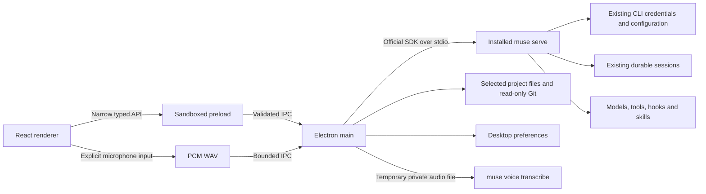

# Architecture

## Stack choice

Electron runs the official Node SDK directly, supports macOS, Windows, and Linux desktop integration with a unified Mac-style frameless window chrome, and gives contributors a TypeScript stack across the protocol boundary and UI. React is responsible only for presentation and interaction. Vite handles the three build targets: main, sandboxed preload, and renderer. This trades a larger application bundle for a direct, maintainable SDK integration. There is no local HTTP server in packaged builds and no application backend service.

## CLI lifecycle

`cli.ts` discovers an executable from the login-shell environment (on macOS and Linux) and standard installation locations across macOS, Linux, and Windows (including `.exe` and `.cmd` wrappers), verifies `--version`, and honors a custom path. Environment output is never logged. `muse-host.ts` owns one SDK stdio connection, initializes it with a compliant client identifier, checks the protocol fingerprint, and folds item revisions through the SDK's `ItemStore`.

The conversation list is paged automatically, and valid project directories are discovered from real session metadata without granting project trust. Saved conversations are read with `excludeItems: false`. When inline history is omitted, durable view pages are folded through `ItemStore`. A read does not claim the session; the first mutating operation resumes it. The CLI enforces session leases. CLI versions that reject unloaded live subscriptions show saved history until resumption; they do not acquire a lease just to display history. Completed item revisions replace accumulated streaming deltas. A view gap triggers unsubscribe, snapshot recovery, pending-request refresh, and subscription from the recovered cursor. Updates are coalesced over 32 ms to avoid rendering every token independently.

Commands use SDK-generated command IDs with one attempt. The app does not blindly retry a mutating command after a lost acknowledgement. Reconnect reads durable history instead. A closed host produces a visible connection error. Closing the Mac window hides it; quitting closes the owned CLI host. Active work prompts before quit or reconnect.

## State ownership

- CLI: authentication, tools, approval policies, model configuration, durable conversations, and output blobs.
- Electron main: trusted projects, recent projects, appearance, pins, archives, temporary attachment handles, session views, native dialogs, and file/Git previews.
- React: selected page and conversation, dialogs, scroll-follow state, and unsent drafts in memory.

No transcript mirror, credential database, or telemetry service is introduced. Pending approval cards carry the current requirement token, including staged requirements. Server labels and choices remain authoritative.

## Verification

Unit coverage checks file containment, symlink rejection, binary and size limits, Git filename parsing, preference persistence, approval freshness, streaming revisions, gap recovery, question answers, follow-up modes, cancellation dispatch, paged transcript recovery, and bounded voice encoding. The integration script exercises the real CLI with its echo provider across a process restart. Playwright drives the real Electron application and real echo CLI, including themes, native bridge rejection cases, project browsing, search, sending, renaming, fresh-install history discovery, themed menu keyboard behavior, and simulated microphone capture/cancellation/draft insertion.

These checks do not replace testing authenticated model tool execution or Developer ID signing on a release candidate.

## Updates

A small Objective-C++ Node-API bridge loads Sparkle 2 from the packaged app's Frameworks directory on the Cocoa main thread. The renderer receives only update status, manual checking, and the automatic-check preference through validated IPC. Development builds do not load the updater. Sparkle owns update preferences in NSUserDefaults; appearance preferences remain independent.

The packaging hook downloads a pinned, SHA-256-verified upstream archive, compiles the bridge for the selected architecture, embeds the framework before Developer ID signing, and sets the public Ed25519 key and architecture-specific feed URL in Info.plist. Feeds and downloaded archives must both be signed. Update installation is user initiated, and the updater refuses a relaunch during an active CLI turn. Normal quit handling shuts down the CLI and cancels transcription. Save drafts and finish voice input before choosing to install.

Daily checks are opt-in, automatic installation and system profiling are disabled. GitHub hosts the feeds and release downloads. Apple notarization remains a separate release requirement. See [releasing](releasing.md).
